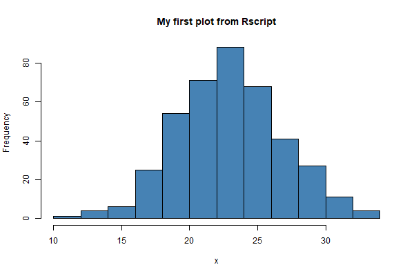

# My C3 Data Science Bootcamp notes

This repository holds my scripts and notes from the UCSF C3 Data Science
Bootcamp, where I learn R, git and machine learning.

Today's class is taught by Henrik Bengtsson.

## What I want to learn

- how to run R scripts from the terminal
- how to use git

## Tools

- Rstudio
- __Git Bash__
- [Positron](https://positron.posit.co/)

## Examples

```sh
Rscript R/my-plot.R
```


